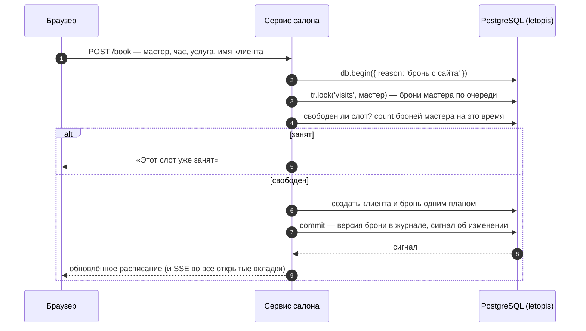

# Салон записи

Веб-приложение для салонов красоты (интерфейс — React и компоненты shadcn/ui, сервер — Express и JSON API): расписание мастеров на день, запись клиента, отмена, возврат и история брони. Каждый салон — отдельный арендатор: данные одного салона другому не видны.

**Запустить:** `docker compose -f services/compose.yaml up --build`, затем открыть http://127.0.0.1:8081.
Демо-входы: `admin@lokony.ru` / `Lokony-2026!` (салон «Локоны»), `admin@lastochka.ru` / `Lastochka-2026!` (салон «Ласточка»).

## Что из letopis здесь работает

| Возможность | Где в сервисе |
|---|---|
| `up({ seeds: ['booking'] })` | при старте ставится схема с готовой моделью салона; повтор безопасен |
| `createTenant` | каждый салон — арендатор со своим управляющим |
| `verifyPassword`, `svc.as()` | вход по паролю; запросы идут от имени управляющего в его салоне |
| цепочки с переходами и фильтрами | расписание: салон → мастера; брони дня по времени начала |
| `db.begin()` + `lock()` | бронь одной транзакцией под блокировкой мастера — двойной брони не бывает |
| ключ `[Staff, start_datetime]` | база сама не даст две брони мастера на одно время |
| `delete` с причиной, `restore`, `versions()` | отмена, возврат, история брони с причинами |
| `.cache()` | каталог услуг читается из кэша, правка сбрасывает его сигналом |
| `watch()` → SSE | вторая вкладка видит новую бронь без перезагрузки |
| `onQuery` | панель «Под капотом»: какие запросы выполнило действие |

## Как устроена бронь

## Нюанс: где живёт сессия пользователя

Токен сессии letopis не кладётся в cookie браузера. Веб-сессия хранится на сервере, cookie несёт только её случайный номер, а запросы идут через фасад `svc.as(аккаунт, { арендатор })`. Метода «токен сессии → аккаунт», которым сервис мог бы проверять cookie с токеном letopis, в библиотеке нет. Это пробел API, вынесенный на решение владельца; до решения сервис работает так, как описано здесь.

Исходники: `services/salon/src/server.mjs` (JSON API и SSE), `services/salon/web/src/App.tsx` (интерфейс на shadcn/ui), `services/salon/src/domain.mjs` (бронь, отмена, история), сценарий «день работы» — `services/salon/scenario.mjs`, проверка в браузере — `services/salon/CHECK.md`.
