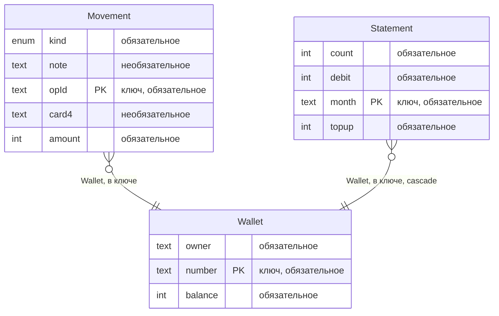
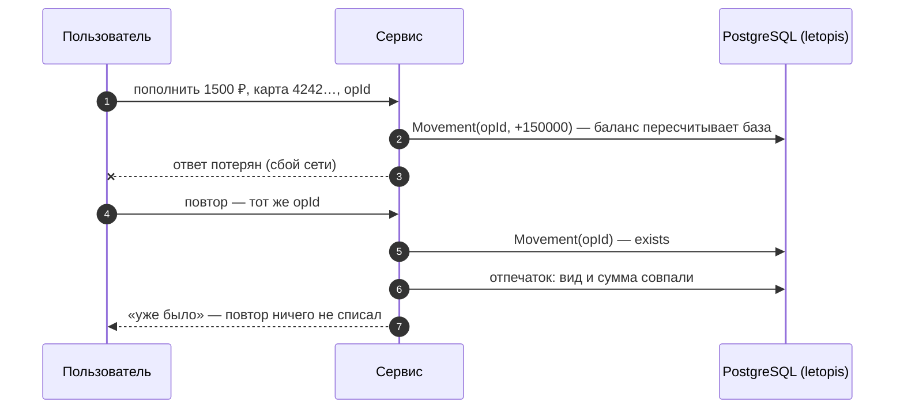

# Кошелёк и биллинг

Счета, пополнение тестовой картой, списания, переводы и выписка по месяцам — без двойного списания. Интерфейс собран из блоков shadcnblocks, сервер — Express и JSON API.

**Запустить в Docker:** `docker compose -f services/compose.yaml up --build wallet` → http://127.0.0.1:8082 (вход `admin@kopeika.ru` / `Kopeika-2026!`, тестовая карта `4242 4242 4242 4242`).

**Запустить руками:** база — `docker compose -f services/compose.yaml up -d pg`, затем `services/wallet/run-local.sh`; шаги для PowerShell — в `services/wallet/README.md`.

## Что из letopis здесь работает

| Возможность letopis | Где в сервисе |
|---|---|
| ключ операции `[Wallet, opId]` | повтор пополнения после «потерянного ответа» — «уже было», деньги не удвоились |
| `commit_unknown` | «Обрыв связи с базой на COMMIT» в диалоге пополнения: связь на деле рвёт TCP-прокси сервиса — до того, как COMMIT дошёл до базы, или после того, как база его выполнила; библиотека не повторяет, сервис повторяет операцию с тем же `opId`: «проведено» — в первый раз не записалось, `exists` («уже было») — записалось |
| агрегат `balance = sum(Movement.amount)` | баланс считает база; уход в минус — отказ: ограничение `min(0)` проверяется для посчитанного баланса |
| `db.begin()` + `lock` в порядке id, `40P01` | перевод между счетами — две операции одной транзакцией без взаимных блокировок; флажок «без порядка блокировок» (сначала свой счёт, пауза между замками) — встречные переводы из двух вкладок ловят настоящую взаимную блокировку, PostgreSQL прерывает один блок, сервис повторяет весь блок `db.begin()` (повторов внутри него библиотека не делает) |
| `update(патч, { rev })` | «Владелец»: правка по версии счёта, прочитанной вместе с ним; счёт успели изменить (другая вкладка или любая операция — баланс тоже поле счёта) — `conflict`, 409 |
| `onDelete: 'restrict'` (по умолчанию) | «Удалить»: счёт с операциями база не удаляет — `delete_restricted`, 409 с числом мешающих операций |
| проектор `statement`: `lockTimeout`, `lockRetries`, `status()`, `rebuild()` | выписка по месяцам из журнала операций, с небольшим отставанием; чужую блокировку строки выписки пачка ждёт не дольше `lockTimeout` (1 с), после `lockRetries` (3) таких проходов подряд арендатор выбывает (`status().failed`, `55P03`); блок выписки показывает `status()`, «Перестроить выписку» — `rebuild({ tenant })` для выбывшего, иначе `rebuild()` |
| `verify({ data: true })` | «Проверить целостность»: цепочки хэшей журнала, данные против описаний классов и `balance` каждого счёта против суммы его операций |
| `versions()` с причиной | история баланса: каждое изменение — версия с причиной операции |
| `watch()` → SSE, `onQuery`, журнал `log`, `flushSignals()` | живое обновление и панель «Под капотом»: цепочки и запросы действия, записанные версии с изменёнными полями (у перевода — две операции `Movement` и `balance` обоих счетов) и сигналы классов, которые записало действие |

## Модель

Счёт (`Wallet`), его операции (`Movement`, ключ — счёт и `opId`) и выписка по месяцам (`Statement` — производный класс проектора `statement`). Схема получена из реестра (`db.describe()`), а не нарисована руками:

<!-- er:wallet -->

<!-- /er -->

## Как проходит операция

