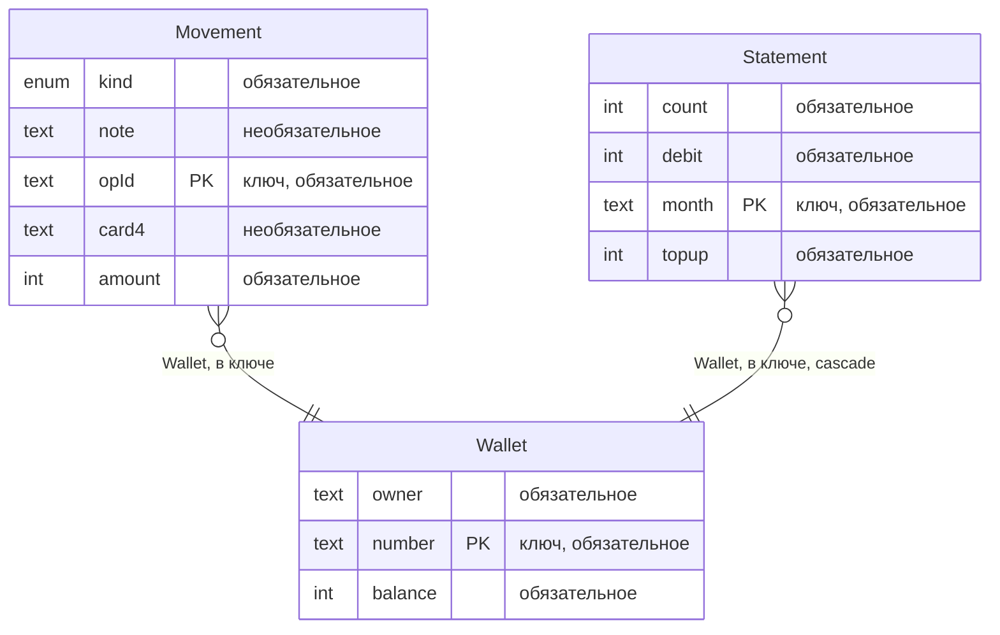
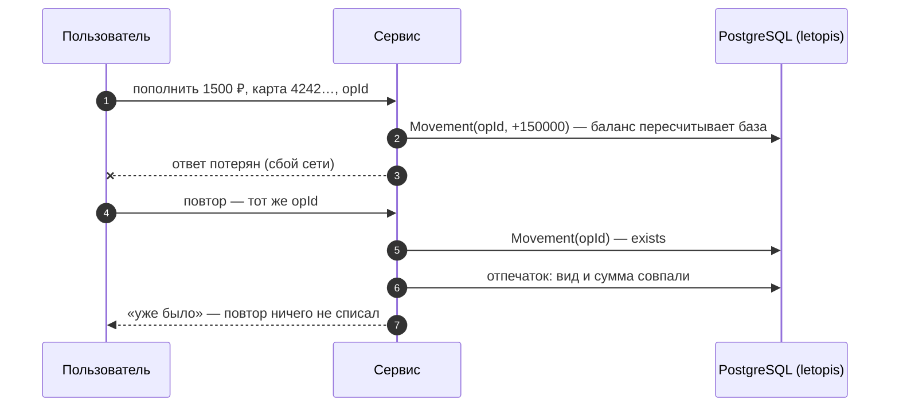

# Кошелёк и биллинг

Счета, пополнение тестовой картой, списания, переводы и выписка по месяцам — без двойного списания. Интерфейс собран из блоков shadcnblocks, сервер — Express и JSON API.

**Запустить в Docker:** `docker compose -f services/compose.yaml up --build wallet`, затем открыть http://127.0.0.1:8082. Вход — `admin@kopeika.ru` / `Kopeika-2026!`, тестовая карта — `4242 4242 4242 4242`.

**Запустить руками:** база — `docker compose -f services/compose.yaml up -d pg`, затем `services/wallet/run-local.sh`. Команды для PowerShell — в `services/wallet/README.md`.

## Что из letopis здесь работает

| Возможность letopis | Где в сервисе |
|---|---|
| ключ операции `[Wallet, opId]` | флажок «потерять ответ» в диалоге пополнения: операция проведена, а ответ до браузера не дошёл. Повтор с тем же `opId` база не записывает (`exists`), сервис сверяет вид и сумму и отвечает «уже было» — баланс вырос один раз |
| `commit_unknown` | «Обрыв связи с базой на COMMIT» в диалоге пополнения. Обрыв настоящий: связь рвёт TCP-прокси сервиса — до того, как COMMIT дошёл до базы, или после того, как база его выполнила. Записалась ли операция, библиотека не знает: она отвечает `commit_unknown` и сама не повторяет. Сервис повторяет операцию с тем же `opId`. Если повтор её провёл, в первый раз она не записалась; если получил `exists` («уже было») — записалась |
| агрегат `balance = sum(Movement.amount)` | баланс считает сама база. Операцию, после которой баланс стал бы отрицательным, она отклоняет: ограничение `min(0)` проверяется на посчитанном балансе |
| `db.begin()` + `lock` в порядке id, `40P01` | перевод между счетами — две операции в одной транзакции `db.begin()`. Оба счёта блокируются в порядке id, поэтому встречные переводы не попадают во взаимную блокировку. С флажком «без порядка блокировок» перевод блокирует сначала свой счёт и только через 2 с — счёт получателя. Встречные переводы из двух вкладок тогда ловят настоящую взаимную блокировку, и PostgreSQL прерывает один из них (`40P01`). Повторов внутри `db.begin()` библиотека не делает — сервис повторяет весь блок |
| `update(патч, { rev })` | «Владелец»: смена владельца по версии счёта, прочитанной вместе с ним. Если счёт за это время изменился (правка в другой вкладке или любая операция: баланс — тоже поле счёта), база отвечает `conflict`, сервис — 409 |
| `onDelete: 'restrict'` (по умолчанию) | «Удалить»: счёт, на который ссылаются операции, база не удаляет — `delete_restricted`. Сервис отвечает 409 и сообщает, сколько операций мешает |
| проектор `statement`: `lockTimeout`, `lockRetries`, `status()`, `rebuild()` | проектор читает журнал операций пачками и пишет по нему выписку по месяцам, с небольшим отставанием. Если строку выписки держит чужая транзакция, пачка ждёт не дольше `lockTimeout` (1 с), затем откатывается и повторяется на следующем проходе. После `lockRetries` (3) таких проходов подряд арендатор выбывает: его изменения проектор пропускает до перестройки (`status().failed`, код `55P03`). Блок «Выписка по месяцам» показывает `status()`. «Перестроить выписку» вызывает `rebuild({ tenant })` для выбывшего арендатора, иначе `rebuild()`. Кнопка «Чужая транзакция: занять выписку» показывает это вживую: транзакция на отдельном подключении задерживает горизонт (проектор читает журнал только до самой старой незавершённой транзакции), после следующего пополнения берёт строку выписки этого счёта `for update` — и через три прохода арендатор выбывает с `55P03`, а сервис сам закрывает чужую транзакцию |
| `verify({ data: true })` | «Проверить целостность» сверяет цепочки хэшей журнала (хэш каждой версии включает хэш предыдущей), данные — с описаниями классов, а `balance` каждого счёта — с суммой его операций. «Испортить запись журнала» меняет баланс в старой версии счёта прямым `UPDATE` в обход библиотеки, и `verify` находит её по хэшу; «Вернуть как было» возвращает данные. Подделать сам баланс так нельзя: триггеры таблицы `entity` работают и в режиме репликации |
| `versions()` с причиной | «История» у счёта: каждое изменение баланса — версия счёта с причиной операции |
| `watch()` → SSE, `onQuery`, журнал `log`, `flushSignals()` | живое обновление: подписка `watch()` сообщает об изменениях, сервер передаёт их во вкладку потоком SSE, и вкладка перечитывает данные. Панель «Под капотом» показывает, что сделало действие: цепочки letopis и запросы к базе (`onQuery`), версии, которые оно записало, с изменёнными полями (из журнала `log`), и сигналы об изменении классов, в которые оно записало (`flushSignals()`; только имя класса). Перевод, например, записывает четыре версии: две операции `Movement` и `balance` обоих счетов |

## Модель

Счёт (`Wallet`), его операции (`Movement`, ключ — счёт и `opId`) и выписка по месяцам (`Statement`) — классы арендатора «Копейка». `Statement` — производный класс: его строки пишет проектор `statement`. При каждом запуске сервиса классы записывает `syncModels` через администраторское подключение letopis (`allowBypassRls`: построчные правила доступа базы, RLS, на него не действуют) в сессии оператора `admin@kopeika.ru`: токен `createTenant` — только на эту запись, после неё сессия гаснет, подключение закрывается. Проектор выписки и `verify` ведёт другое администраторское подключение — без сессии: проектор пишет от роли владельца схемы, `verify` пускает роль подключения, поэтому простой сервиса им не мешает. Веб-сессия пользователя модель не пишет: производный класс описывает только администратор. Классы лежат в арендаторе сервиса, а не в System: классы System `syncModels` пропускает, их пишет только `up()` из сида, а сид не меняет класс, который уже есть. Будь классы в System, правка модели не дошла бы до уже работающей установки.

Схема получена из реестра (`db.describe()`), а не нарисована руками:

<!-- er:wallet -->

<!-- /er -->

## Как проходит операция

