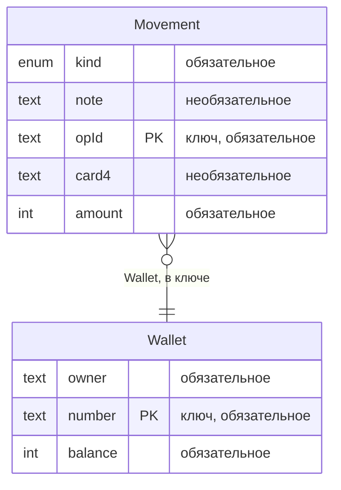
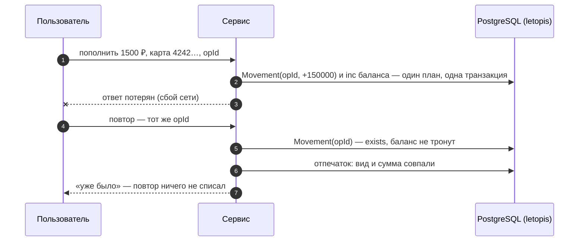
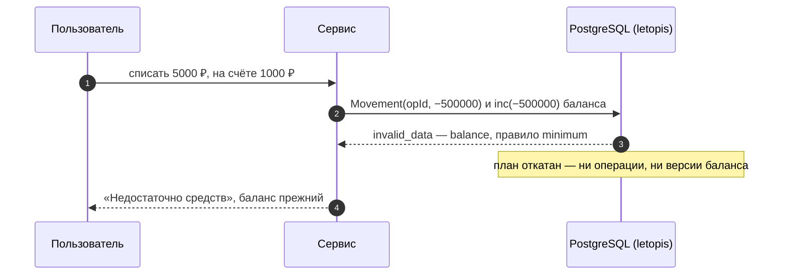

# Кошелёк и биллинг

Счета, пополнение тестовой картой, списания, переводы и выписка по месяцам — без двойного списания. Баланс — поле счёта: операция и приращение баланса (`inc`) пишутся одним планом записи, одной транзакцией, а правило `min(0)` база проверяет над итогом. Выписку по месяцам сервис считает обычным запросом при каждом показе. Интерфейс собран из блоков shadcnblocks, сервер — Express и JSON API.

**Сначала — исходники.** Сервисы лежат в [репозитории letopis](https://github.com/alepri51/letopis), а не в npm-пакете: `git clone https://github.com/alepri51/letopis && cd letopis` — все команды ниже выполняются из корня клона ([как запустить](./#run)).

**Запустить в Docker:** `docker compose -f services/compose.yaml up --build wallet`, затем открыть адрес сервиса — по умолчанию http://127.0.0.1:8082 (порт меняет переменная `WALLET_PORT`, [как запустить](./#run)). Вход — `admin@kopeika.ru` / `Kopeika-2026!`, тестовая карта — `4242 4242 4242 4242` (или `5555 5555 5555 4444`); срок и CVC — любые, например `12/30` и `123`: форма требует их заполнить, но сервис их не проверяет и не хранит, номер карты проверяется только по алгоритму Луна.

**Запустить руками:** база — `docker compose -f services/compose.yaml up -d pg` (или своя, её мастер-ключ — в `ADMIN_DSN`), затем `services/wallet/run-local.sh`: дом строит `node src/setup.mjs`, сервер получает только пропуск. Команды для PowerShell — в `services/wallet/README.md`.

## Что из letopis здесь работает

| Возможность letopis | Где в сервисе |
|---|---|
| `setup(ADMIN_DSN, 'wallet', { models })`, `connect(pass)` | подготовка дома (`src/setup.mjs`) мастер-ключом записывает модель счёта и операции; та же подготовка заводит квартиру «Копейка», зовёт оператора Ольгу с ролью `owner` (приглашение идёт через почтальона-заглушку и тут же принимается) и, если счетов нет, заводит в квартире два счёта (`db.in('Копейка')`). Сервис знает только пропуск и жильцов при старте не заводит |
| `db.open({ email, password })`, `db.resume(token)` | вход оператора паролем: токен сессии — в cookie, каждый запрос открывает по нему корень квартиры; выход — `me.close()` |
| ключ операции `[Wallet, opId]` | флажок «потерять ответ» в диалоге пополнения: операция проведена, а ответ до браузера не дошёл. Повтор с тем же `opId` база не записывает (`exists`), сервис находит прежнюю операцию по id из ключа (`me.idOf('Movement', { Wallet, opId })`), сверяет вид и сумму и отвечает «уже было» — баланс вырос один раз |
| `commit_unknown` | «Обрыв связи с базой на COMMIT» в диалоге пополнения. Обрыв настоящий: операция идёт через отдельного консьержа, чьё соединение проходит через TCP-прокси сервиса, и прокси рвёт связь — до того, как COMMIT дошёл до базы, или после того, как база его выполнила. Записалась ли операция, библиотека не знает: она отвечает `commit_unknown` и сама не повторяет. Сервис повторяет операцию с тем же `opId` обычным корнем. Если повтор её провёл, в первый раз она не записалась; если получил `exists` («уже было») — записалась |
| `inc` в плане операции, `min(0)` над итогом | пополнение, списание и перевод: операция — один план записи `me.Wallet(счёт).Movement().create({ opId, kind, amount }).Wallet().update({ balance: inc(amount) })`, строка `Movement` и приращение баланса её счёта — одной транзакцией. `inc` прибавляет внутри `UPDATE` над заблокированной строкой счёта, поэтому параллельные операции не теряются. Правило `min(0)` база проверяет над итогом приращения: операцию, после которой баланс стал бы отрицательным, она отклоняет (`invalid_data`), и план откатывается целиком — нет ни операции, ни версии баланса. Нехватку средств сервис отличает от других ошибок данных по `e.issues`: поле `balance`, правило `minimum` |
| `begin()` + `lock` в порядке id, `40P01` | перевод между счетами — две операции, каждая с `inc` баланса своего счёта, в одной транзакции `me.begin()`. Оба счёта блокируются в порядке id, поэтому встречные переводы не попадают во взаимную блокировку. С флажком «без порядка блокировок» перевод блокирует сначала свой счёт и только через 2 с — счёт получателя. Встречные переводы из двух вкладок тогда ловят настоящую взаимную блокировку, и PostgreSQL прерывает один из них (`40P01`). Повторов внутри `begin()` библиотека не делает — сервис повторяет весь блок, до трёх попыток |
| `update(патч, { rev })` | «Владелец»: смена владельца по версии счёта, прочитанной вместе с ним. Если счёт за это время изменился (правка в другой вкладке или любая операция: баланс — тоже поле счёта), база отвечает `conflict`, сервис — 409 |
| `onDelete: 'restrict'` (по умолчанию) | «Удалить»: счёт, на который ссылаются операции, база не удаляет — `delete_restricted`. Сервис отвечает 409 и сообщает, сколько операций мешает |
| `me.transaction` — свой SQL под правами жильца | «Выписка по месяцам» — обычный запрос на чтение: операции, сведённые по счёту и месяцу (`group by`), в транзакции сессии оператора. Права те же, что у цепочек, поэтому видны только операции своей квартиры — «Копейки». Отдельного класса и процесса нет: выписка считается при каждом показе и всегда совпадает с операциями. Пополнено — приходы (пополнения и входящие переводы), списано — расходы (списания и исходящие переводы) |
| `versions()` с причиной | «История» у счёта: каждое изменение баланса — версия счёта с причиной операции |
| `watch()` → SSE, `onQuery`, журнал `log`, сигналы | живое обновление: подписка `watch()` сообщает об изменениях, сервер передаёт их во вкладку потоком SSE, и вкладка перечитывает данные. Панель «Под капотом» показывает, что сделало действие: цепочки letopis и запросы к базе (`onQuery`), версии, которые оно записало, с изменёнными полями (из журнала `log`), и сигналы об изменении классов, в которые оно записало (только имя класса). Перевод, например, записывает четыре версии: две операции `Movement` и `balance` обоих счетов |

## Модель

Счёт (`Wallet`, баланс `balance` — целые копейки, `min(0)`) и его операции (`Movement`, ключ — счёт и `opId`) — общие классы дома `wallet`: их записывает подготовка `setup(ADMIN_DSN, 'wallet', { models: [Wallet, Movement] })`. Строки счетов и операций при этом лежат в квартире «Копейка» и видны только её жильцам. Правка модели доходит до работающего дома повторным `setup()` с новой моделью — его запускает шаг подготовки при каждом развёртывании. Веб-сессия оператора модель не пишет.

Схема получена из реестра корня квартиры (`me.registry`), а не нарисована руками:

<!-- er:wallet -->

<!-- /er -->

## Как проходит операция

Списание больше баланса база отклоняет над итогом приращения, и план откатывается целиком:

