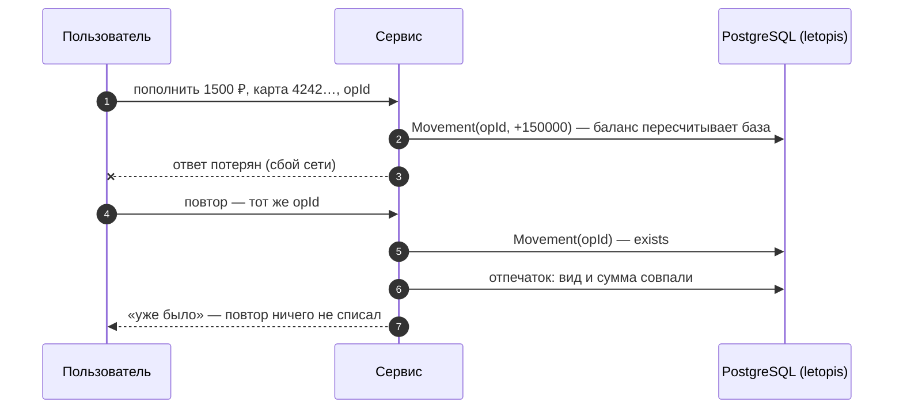

# Кошелёк и биллинг

Счета, пополнение тестовой картой, списания, переводы и выписка по месяцам — без двойного списания. Интерфейс собран из блоков shadcnblocks, сервер — Express и JSON API.

**Запустить в Docker:** `docker compose -f services/compose.yaml up --build wallet` → http://127.0.0.1:8082 (вход `admin@kopeika.ru` / `Kopeika-2026!`, тестовая карта `4242 4242 4242 4242`).

**Запустить руками:** база — `docker compose -f services/compose.yaml up -d pg`, затем `services/wallet/run-local.sh`; шаги для PowerShell — в `services/wallet/README.md`.

| Возможность letopis | Где в сервисе |
|---|---|
| ключ операции `[Wallet, opId]` | повтор пополнения после «потерянного ответа» — «уже было», деньги не удвоились |
| агрегат `balance = sum(Movement.amount)` | баланс считает база; уход в минус — отказ правилом `min(0)` над итогом |
| `db.begin()` + `lock` в порядке id | перевод между счетами — две операции одной транзакцией без взаимных блокировок |
| проектор `statement` | выписка по месяцам из журнала операций, с небольшим отставанием |
| `versions()` с причиной | история баланса: каждое изменение — версия с причиной операции |
| `watch()` → SSE, `onQuery` | живое обновление и панель «Под капотом» |

