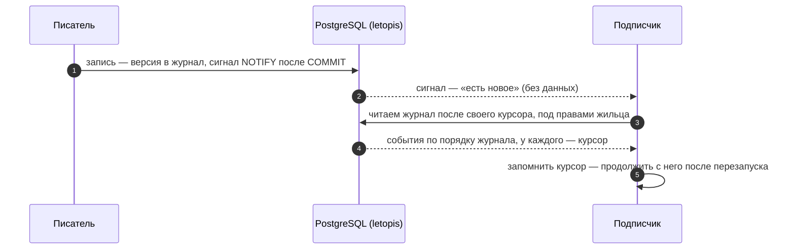
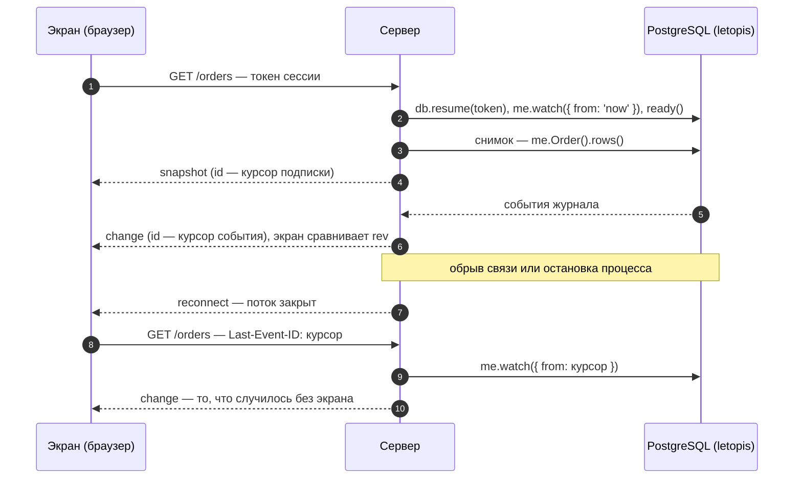
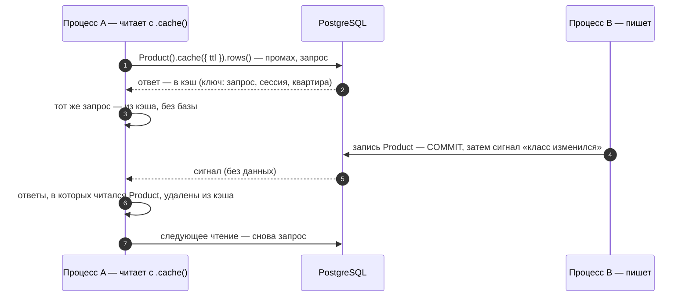

# Подписка, кэш и сигналы

## Зачем

**Подписка** (`me.watch()`) отдаёт изменения классов по порядку журнала — для живых экранов, уведомлений, интеграций. **Кэш** хранит ответы цепочек в памяти процесса и сбрасывается сам, когда данные меняются. И подписка, и кэш узнают об изменениях по **сигналам** — коротким уведомлениям базы (PostgreSQL `NOTIFY`) о том, что данные изменились.

Подписку открывает корень квартиры — `me.watch()`. Журнал она читает под его правами: у жильца, вошедшего ключом, события приходят только из его квартиры и только о тех строках, которые ему видны.

## Пример: подписка по курсору

<Example id="watch/01-subscription" />

## Что внутри: как подписка узнаёт о новом

<Flow name="watch" />

## Пример: курсор подписки не устаревает

<Example id="watch/02-quiet-cursor" />

Журнал хранит каждую версию, поэтому сохранённый курсор годится сколько угодно долго: и курсор подписки `sub.cursor` (позиция после последнего выданного события), и курсор события `ev.cursor` (позиция после этого события). Новая подписка с любого из них получает ровно то, что случилось после, — после перезапуска процесса, после обслуживания дома (`letopis maintain` журнал не трогает) и сколько угодно времени спустя. О новом классе корень квартиры узнаёт по сигналу, с задержкой: описания классов он держит в памяти (реестр классов), а сразу их перечитывает `me.refresh()`.

## Рецепт: живой экран

Экран, который показывает данные и сам обновляется, собирают из подписки и снимка. Сервер на каждый поток экрана:

1. открывает подписку `me.watch({ from: 'now' })` у корня жильца (`db.resume(token)` по токену из cookie) и ждёт `await sub.ready()` — с этого момента ни одна запись не пройдёт мимо;
2. читает **снимок** — то, что экран покажет сразу, — и отдаёт его первым событием потока;
3. шлёт события подписки по одному, каждое со своим курсором (`ev.cursor`) в поле `id` кадра SSE.

Клиент хранит у каждой строки номер версии `rev`, которую показывает, и отбрасывает события версий не новее: запись, сделанная между `ready()` и снимком, есть и в снимке, и в событиях. Поток оборвался — клиент переподключается с курсором последнего события (браузерный `EventSource` сам шлёт его заголовком `Last-Event-ID`), и сервер открывает подписку с этого курсора, без снимка: ничего не потеряно и не показано дважды.

<Example id="watch/03-live-screen" />

Что важно в рецепте:

- **Подписка — раньше снимка.** Снимок, снятый до подписки, теряет запись, сделанную между снимком и `ready()`: её нет ни в снимке, ни в потоке.
- **Ошибку не глотать.** Обрыв связи с базой приходит исключением из цикла `for await` (подписка после него закрыта, следующий `next()` бросает ту же ошибку), а остановка процесса и `close()` консьержа кончают цикл без ошибки. В обоих случаях сервер говорит клиенту и закрывает поток — иначе экран ждал бы событий из мёртвого потока. Клиент переподключается с курсора.
- **Сессия кончилась — не переподключаться.** `db.resume(token)` с погашенным токеном отвечает `auth_failed`: сервер шлёт `error`, клиент закрывает экран и просит войти заново.
- **Выход закрывает потоки сам.** Подписка жильца, чью сессию погасили (`me.close()`, `closeAll()`, выписка), не падает, а молчит: журнал под правами погашенной сессии пуст. Поэтому приложение при выходе закрывает подписки этой сессии само.
- **Порядок — по журналу, версии — по `rev`.** События идут в порядке номеров транзакций, а не фиксации; сравнивайте версии одной строки по `rev`.

## Кэш результатов

Кэш хранит ответы цепочек в памяти процесса: тот же запрос с `.cache({ ttl })` (или по классу с `cache` в модели) отвечает без базы, пока данные не изменились. Кэш один на консьержа (`connect(pass, { cache })`) и общий для всех корней квартир, которые он открыл; в ключе ответа — запрос, сессия, аккаунт и квартира, поэтому один жилец не получит ответ другого. Сбрасывает кэш тот же сигнал, что будит подписку:

- **Своя запись** сбрасывает кэш сразу после фиксации, не дожидаясь сигнала; запись через `me.sql` — весь кэш.
- **Ответ старше `ttl`** не отдаётся; ответ, во время чтения которого пришёл сигнал, в кэш не кладётся (счётчик `raced` в `me.cache.stats()`).
- **Без сигналов** (дом с `setup({ signals: 'none' })`, PgBouncer) кэш работает только по сроку: `connect(pass, { cache: { ttlOnly: true } })`.

Живые примеры: [опции кэша консьержа](../install/#ex-install-03-connect-options), [кэш только по сроку и `cache.clear()`](../ops/#ex-ops-02-sql-cache-signals) (шаг 3).

## Сигналы

Режим сигналов задаёт `setup({ signals })` для всего дома: `class` (по умолчанию) — сигнал называет изменённый класс; `tenant` — ещё и квартиру (её токеном), поэтому записи одной квартиры не будят подписки и кэш другой; `opaque` — класс и квартира в сигнале — токены, по которым их узнаёт только консьерж (у него ключ сигналов); `none` — база сигналов не шлёт, подписка опрашивает журнал, кэш — только по сроку. Сигналы своих записей консьерж копит и шлёт раз в `notifyIntervalMs` (по умолчанию 100 мс); сразу — `me.flushSignals()`.

## Подводные камни

- **Сигнал — только подсказка.** Он не несёт данных; события подписчик читает из журнала под своими правами — чужое не придёт.
- **`from: 'now'` — с текущего момента:** записи до `await sub.ready()` могут не попасть в поток.
- **Курсор — для продолжения без потерь и повторов,** и он не устаревает: журнал хранит каждую версию. Обработав событие, сохраняйте `sub.cursor` (позиция после последнего выданного события) и продолжайте с него после перезапуска; с `ev.cursor` поток тоже продолжится — после этого события.
- **Подписка погашенной сессии молчит.** Ошибки нет — журнал под её правами пуст; закрывайте подписки при выходе жильца сами ([рецепт выше](#рецепт-живои-экран)).
- **Неизвестная опция `me.watch()` — отказ** `invalid_data` с похожими именами.
- **Кэш хранится в памяти каждого процесса.** Если приложение запущено в нескольких экземплярах, кэш одного из них может отставать на доли секунды — деньги читайте без кэша.
- **Если консьерж не слушает сигналы** (`connect(pass, { listen: false })` или PgBouncer в режиме транзакций, где `LISTEN` недоступен), кэш выключен (кроме кэша по сроку — `cache: { ttlOnly: true }`), а подписка опрашивает журнал раз в `pollMs`.

## Где это в сервисах

Расписание салона, счета кошелька, очередь заявок helpdesk и документы обновляются во всех открытых вкладках сами: сервер держит подписку корня квартиры вошедшего человека и передаёт события в браузер потоком Server-Sent Events (SSE), а вкладка перечитывает данные. Ошибка подписки уходит во вкладку отдельным событием, и вкладка переподключается; выход закрывает потоки этой веб-сессии.
