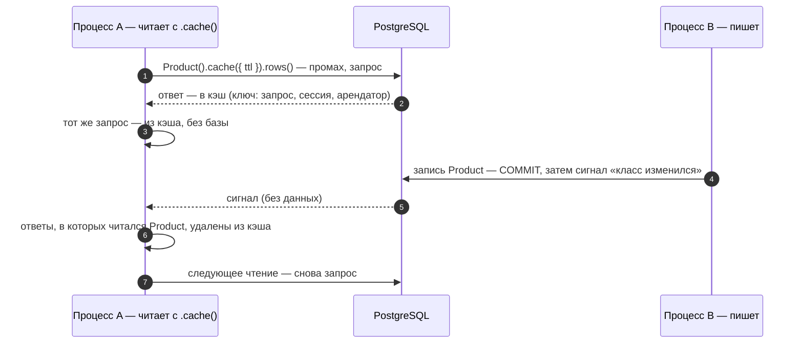

# Подписка, кэш и сигналы

## Зачем

**Подписка** (`db.watch`) отдаёт изменения классов по порядку журнала — для живых экранов, уведомлений, интеграций. **Кэш** хранит ответы цепочек в памяти процесса и сбрасывается сам, когда данные меняются. И подписка, и кэш узнают об изменениях по **сигналам** — коротким уведомлениям базы (PostgreSQL `NOTIFY`) о том, что данные изменились.

## Пример: подписка по курсору

<Example id="watch/01-subscription" />

## Что внутри: как подписка узнаёт о новом

<Flow name="watch" />

## Пример: курсор подписки без событий не устаревает

<Example id="watch/02-quiet-cursor" />

## Кэш результатов

Кэш хранит ответы цепочек в памяти процесса: тот же запрос с `.cache({ ttl })` (или по классу с `cache` в модели) отвечает без базы, пока данные не изменились. Сбрасывает его тот же сигнал, что будит подписку:

- **Своя запись** сбрасывает кэш сразу после фиксации, не дожидаясь сигнала.
- **Ответ старше `ttl`** не отдаётся; ответ, во время чтения которого пришёл сигнал, в кэш не кладётся (счётчик `raced` в `db.cache.stats()`).
- **Без сигналов** (режим `none`, PgBouncer) кэш работает только по сроку: `connect({ cache: { ttlOnly: true } })`.

Живые примеры: [кэш и описание класса](../write/#ex-write-06-link-verbs) (шаг 5), [кэш только по сроку и `db.cache.clear()`](../ops/#ex-ops-03-describe-sql-cache) (шаг 4).

## Подводные камни

- **Сигнал — только подсказка.** Он не несёт данных; события подписчик читает из журнала под своими правами — чужое не придёт.
- **`from: 'now'` — с текущего момента:** записи до `await sub.ready()` могут не попасть в поток.
- **Курсор — для продолжения без потерь и повторов;** слишком старый курсор (журнал уже прорежен) — `cursor_expired`. Сохраняйте курсор подписки `sub.cursor`: догнав журнал, подписка обновляет в нём время, а курсор события `ev.cursor` хранит время события и после суток затишья уже не годится.
- **Кэш хранится в памяти каждого процесса.** Если приложение запущено в нескольких экземплярах, кэш одного из них может отставать на доли секунды — деньги читайте без кэша.
- **Если подключение не слушает сигналы** (`listen: false` или PgBouncer в режиме транзакций, где `LISTEN` недоступен), кэш выключен (кроме кэша по сроку — `cache: { ttlOnly: true }`), а подписка опрашивает журнал.

## Где это в сервисах

Расписание салона и счета кошелька обновляются во всех открытых вкладках сами: сервер держит подписку и передаёт события в браузер потоком Server-Sent Events (SSE).
