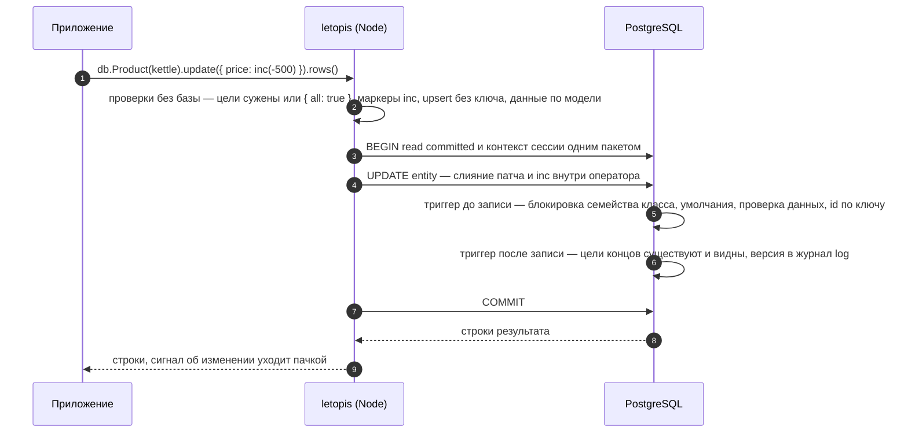

# Запись: создать, изменить, заменить

## Зачем

Запись нужна, чтобы создавать и менять объекты, — а база при этом сама проверяет данные и права и сохраняет прежнюю версию в журнале.

Запись в letopis — это **цепочка** вызовов: шаги выбирают объекты, глагол говорит, что с ними сделать, а терминал — завершающий вызов вроде `rows()` — отправляет запрос в базу:

```ts
await db.Shop(shop).Product({ price: gte(1000) }).update({ title: 'Чайник стеклянный' }).rows()
//     └──── шаги: кого правим ─────────┘ └──── глагол: что делаем ────┘ └ терминал ┘
```

Глагол сам по себе ничего не делает: пока не вызван терминал (`rows`, `first`, `ids`, `count`), это только план. Весь план — **одна транзакция**: ошибка в любом звене откатывает всё.

## Пример: create, update, upsert

<Example id="write/01-create-update-upsert" />

Как выбрать глагол:

| Глагол | Если объекта нет | Если объект есть |
|---|---|---|
| `create` | создаёт | отказ `exists` (у класса с ключом) |
| `update` | ничего (пустой ответ) | меняет только переданные поля (вложенные объекты — по полям, массивы — целиком), остальные оставляет как есть |
| `upsert` | создаёт | заменяет данные **целиком** |

**Какие строки правит `update`.** Цели сужают фильтр, id, `tags()`, `owner()` или `limit()` хотя бы у одного шага цепочки (или `create()` и `upsert()` раньше в ней, или `data.id` в патче). Без них — отказ `invalid_query` ещё до записи: так библиотека ловит правку всех строк по ошибке (строгий режим). Править все строки шага — явно: `db.Product().update({ views: 0 }, { all: true })`. То же правило у `delete({ confirm: true })` — [глава 6](../delete/).

## Что внутри: путь одной записи

<Flow name="write" />



Проверки делает база, а не только библиотека: те же триггеры сработают и на сыром SQL от роли приложения.

## Концы: из пути цепочки и вызовами `.Роль.set()`, `.add()`, `.remove()`

<Example id="write/02-ends-and-slots" />

::: warning Конец — не поле данных
Конец связи в `create()` полем не передают: `db.Item(item).Loan().create({ issuedAt, Member: memberId })` получит `invalid_data` «данные не проходят описание класса Loan» — для базы `Member` лишнее поле (в `issues` — правило `additionalProperties` с пустым путём). Второй конец задают вызовом роли после глагола: `db.Item(item).Loan().create({ issuedAt }).Member.set(memberId).rows()`. Концы полем пишут только во входных строках загрузчика `db.load` ([глава 12](../load/)).
:::

Конец существующего объекта меняют шагом роли: одиночную — `set` и `unset`, множественную — `add` и `remove`. Здесь же — что `await` цепочки ничего не читает, как продолжить путь с готовой строки (`db.entity`) и как повторить чтение из кэша (`.cache()`):

<Example id="write/06-link-verbs" />

## Числа, счётчики и защита от параллельной правки

<Example id="write/03-inc-and-rev" />

Когда что брать:

- **`inc(n)`** — когда нужно прибавить или вычесть, не читая значение: остатки, просмотры, деньги. Параллельные приращения не теряются, а ограничение модели (`min(0)`) проверяется для получившегося значения.
- **`{ rev }`** — когда новое значение вычислено из прочитанного: «прочитал цену, посчитал скидку, записал». Если строку успели изменить — `conflict`, и ничего не записано.
- **Не фильтр `update()`.** `db.Item({ id, status: 'free' }).update(…)` при одновременных запросах пройдёт у обоих: условие фильтра проверяется до записи и заново не проверяется. «Одна открытая выдача на вещь» — ключом, решение по прочитанному — `forUpdate()` в `db.begin()` или `{ rev }`: пример гонки — в [главе 7](../money/#одна-открытая-запись-на-объект-выдача-бронь-смена).
- Деньги храните **целым числом копеек** (не больше 2^53 − 1).

## Ключ и класс неизменны

<Example id="write/04-key-class-immutable" />

Ключевые поля, класс, id, арендатор и владелец строки правкой не меняются — `immutable_key`, в том числе у сырого `UPDATE … SET class`: id объекта класса с ключом вычисляется из арендатора, класса и ключа (UUID v5). Объект с другим ключом или классом — новый объект: создайте его (`create`), переведите на него концы ссылающихся строк их правкой и удалите прежний — лучше одной транзакцией `db.begin()`. У нового объекта своя история, история прежнего остаётся в журнале ([глава 10](../history/)); связать их — забота приложения, например причиной записи (`reason`).

## Батч, теги, владелец, причина

<Example id="write/05-batch-tags-reason" />

## Журнал правки многих строк

Когда одна правка задевает много строк, их версии уходят в журнал одним оператором — в порядке id объектов. Порядок не зависит от того, как база обошла таблицу, поэтому журнал (и всё, что его читает: подписки и срезы на момент) одинаков от прогона к прогону.

<Example id="write/07-mass-journal-order" />

## Подводные камни

- **`update` без условий — отказ.** `db.Product().update(…)` без фильтра, id, `tags()`, `owner()` и `limit()` даёт `invalid_query` и ничего не пишет; все товары арендатора правит только явное `update(…, { all: true })`.
- **Сужают правку модификаторы до глагола.** `db.Product().sort('data.price', 'desc').limit(1).update(…)` правит один товар. Модификатор после глагола — `db.Product().update(…).limit(1).rows()` — даёт `invalid_query` и ничего не пишет: сузить уже нечего.
- **Оператор в `.tags(…)` перед `update` только отбирает.** `.tags(has('зима'))` найдёт строки с тегом и оставит их теги как есть, а строка или список (`.tags('зима')`) ещё и заменят теги целиком.
- **`hasAll([])` подходит любой строке.** Пустой список, пришедший от пользователя, перед `update` или `delete` заденет все строки шага — проверяйте его до запроса.
- **Пустой ответ — не ошибка.** Если шаг ничего не нашёл, `update` вернёт пустой список. Проверяйте длину. При гонке фильтр по данным перепроверяется под блокировкой: из двух одновременных правок одной строки пройдёт одна, вторая получит пустой ответ. Правило «одна открытая запись на объект» держит ключ, решение «прочитал — проверил — записал» — `forUpdate()` или `{ rev }` ([глава 7](../money/#одна-открытая-запись-на-объект-выдача-бронь-смена)).
- **Конец — не поле данных.** `create({ …, Member: id })` — `invalid_data`; конец задают `.Member.set(id)` после глагола.
- **`upsert` заменяет целиком.** Поля, которых нет в переданном объекте, пропадут. И он затирает параллельные приращения — для денег используйте `inc`.
- **`upsert` нужен ключ** — иначе `no_key` ещё до обращения к базе.
- **`{ rev }` — только для одной цели.** На несколько строк — `rev_ambiguous`.
- **`inc` из JSON не получить.** `{ "$inc": 5 }`, пришедший из сети, остаётся данными — подделать приращение нельзя.
- **Ключ и класс правкой не сменить** (`immutable_key`). Другой ключ или класс — новый объект с новым id: концы ссылающихся строк на него переводит приложение, а строки, у которых этот конец входит в ключ, тоже придётся создать заново.
- **У каждого объекта подключения — своя очередь батча.** Батч (`db.batch(имя)`) копит несколько планов и выполняет их одной транзакцией. `db`, каждый `db.as()` и каждый `db.begin()` — отдельные объекты; план выполняется от имени того из них, через который его положили в очередь.

## Где это в сервисах

В салоне бронь создаётся одним планом. В кошельке суммы меняются только приращениями внутри базы. В документах каждая правка договора несёт причину (`reason`) — она видна в истории.
