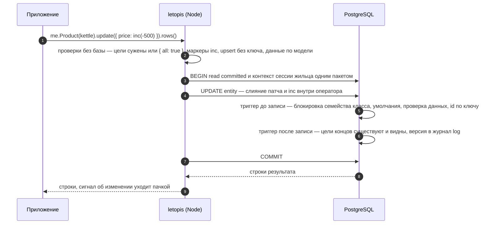

# Запись: что внутри

Продолжение страницы [«Запись: создать, изменить, заменить»](../write/). Там — как записать: глаголы, концы, счётчики, батч. Здесь — что при этом происходит в базе, чего правкой не изменить и на чём спотыкаются.

## Что внутри: путь одной записи

<Flow name="write" />

Проверки делает база, а не только библиотека: те же триггеры и права сработают и на сыром SQL (`me.sql`) в обход цепочек.

## Числа, счётчики и защита от параллельной правки

<Example id="write/03-inc-and-rev" />

Когда что брать:

- **`inc(n)`** — когда нужно прибавить или вычесть, не читая значение: остатки, просмотры, деньги. Параллельные приращения не теряются, а ограничение модели (`min(0)`) проверяется для получившегося значения.
- **`{ rev }`** — когда новое значение вычислено из прочитанного: «прочитал цену, посчитал скидку, записал». Если строку успели изменить — `conflict`, и ничего не записано.
- **Фильтр `update()` по полям — одна строка, одна правка.** Если у шага фильтр не только по id (поля данных, концы, фильтр родителя, `tags()`, `owner()`), цели блокируются и читаются заново: из двух одновременных `me.Order({ id, status: 'new' }).update({ status: 'paid' })` проходит один, второй ждёт блокировку, видит `status: 'paid'` и возвращает пустой ответ, ничего не записав. Фильтр **только по id** (`me.Order(id)`) перепроверять нечего: обе правки пройдут по очереди, вторая поверх первой — тогда `{ rev }` или `inc`. Правило между строками («одна открытая запись на объект») фильтр не удержит — его держит ключ; решение по прочитанному — `forUpdate()` в `me.begin()` или `{ rev }`: пример гонки — в главе [«Транзакции и деньги»](../money/#одна-открытая-запись-на-объект-выдача-бронь-смена).
- **Повтор после сбоя** безопасен только у операции с ключом: `exists` значит «уже записано». Голый `inc()` при повторе прибавит второй раз — деньги пишут операцией с ключом ([«Транзакции и деньги»](../money/#деньги-без-двоиного-списания)).
- Деньги храните **целым числом копеек** (не больше 2^53 − 1).

## Ключ и класс неизменны

<Example id="write/04-key-class-immutable" />

Ключевые поля, класс, id, квартира и владелец строки правкой не меняются — `immutable_key`, в том числе у сырого `UPDATE … SET class`: id объекта класса с ключом вычисляется из квартиры, класса и ключа (UUID v5). Объект с другим ключом или классом — новый объект: создайте его (`create`), переведите на него концы ссылающихся строк их правкой и удалите прежний — лучше одной транзакцией `me.begin()`. У нового объекта своя история, история прежнего остаётся в журнале ([«История и время»](../history/)); связать их — забота приложения, например причиной записи (`reason`).

## Журнал правки многих строк

Когда одна правка задевает много строк, их версии уходят в журнал одним оператором — в порядке id объектов. Порядок не зависит от того, как база обошла таблицу, поэтому журнал (и всё, что его читает: подписки и срезы на момент) одинаков от прогона к прогону.

<Example id="write/07-mass-journal-order" />

## Подводные камни

- **`update` без условий на цели — отказ.** `me.Product().update(…)` без фильтра, id, `tags()`, `owner()` и `limit()` даёт `invalid_query` и ничего не пишет; все товары квартиры правит только явное `update(…, { all: true })`.
- **Сужают правку модификаторы до глагола.** `me.Product().sort('data.price', 'desc').limit(1).update(…)` правит один товар. Модификатор после глагола — `me.Product().update(…).limit(1).rows()` — даёт `invalid_query` и ничего не пишет: сузить уже нечего.
- **Оператор в `.tags(…)` перед `update` только отбирает.** `.tags(has('зима'))` найдёт строки с тегом и оставит их теги как есть, а строка или список (`.tags('зима')`) ещё и заменят теги целиком.
- **Теги — у шага класса, перед глаголом.** `me.Product().tags(['зима']).create(…)` создаёт строку с тегами; у корня шага `tags` нет: `me.tags([…])` — `invalid_class`, как неизвестный класс.
- **`forUpdate()` требует права на правку.** Блокировка «прочитал — проверил — записал» берёт строки как для правки: если жилец строки видит, но править их не может, ответ — `acl_denied` (ключ `api.lock_denied`, id таких строк — в `err.detail.ids`), ничего не заблокировано.
- **`hasAll([])` подходит любой строке.** Пустой список, пришедший от пользователя, перед `update` или `delete` заденет все строки шага — проверяйте его до запроса.
- **Фильтр родителя тоже сужает правку.** `me.Shop(shop).Product().update(…)` не требует `{ all: true }` и правит **все товары магазина**: фильтр есть у шага `Shop`. Править один товар — его id или фильтр у шага `Product`.
- **Пустой ответ — не ошибка.** Если шаг ничего не нашёл, `update` вернёт пустой список. Проверяйте длину. При гонке фильтр по полям перепроверяется под блокировкой: из двух одновременных правок одной строки пройдёт одна, вторая получит пустой ответ; фильтр только по id не перепроверяется — обе правки пройдут, вторая поверх первой. Правило «одна открытая запись на объект» держит ключ, решение «прочитал — проверил — записал» — `forUpdate()` или `{ rev }` ([«Транзакции и деньги»](../money/#одна-открытая-запись-на-объект-выдача-бронь-смена)).
- **Конец — не поле данных.** `create({ …, Shop: id })` — `invalid_data` (`write.link_in_data`); конец задают путём цепочки или `.Shop.set(id)` после глагола.
- **`upsert` заменяет целиком.** Поля, которых нет в переданном объекте, пропадут. И он затирает параллельные приращения — для денег используйте `inc`.
- **`upsert` нужен ключ** — иначе `no_key` ещё до обращения к базе.
- **`{ rev }` — только для одной цели.** На несколько строк — `rev_ambiguous`.
- **`inc` из JSON не получить.** `{ "$inc": 5 }`, пришедший из сети, остаётся данными — подделать приращение нельзя.
- **Ключ и класс правкой не сменить** (`immutable_key`). Другой ключ или класс — новый объект с новым id: концы ссылающихся строк на него переводит приложение, а строки, у которых этот конец входит в ключ, тоже придётся создать заново.
- **У каждого корня — своя очередь батча.** Батч (`me.batch(имя)`) копит несколько планов и выполняет их одной транзакцией. Корень жильца `me`, корни консьержа `db.in()` и `db.as()` и каждая `me.begin()` — отдельные объекты; план выполняется от имени того из них, через который его положили в очередь.
